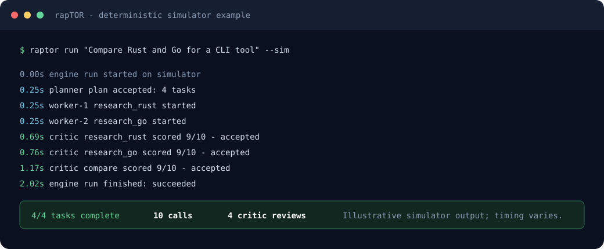
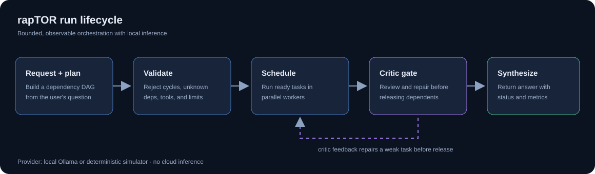

<div align="center">

# rapTOR

**A multi-agent orchestrator you can actually trust to fail honestly.**

It plans a request into a dependency graph, runs independent tasks in parallel, has a critic review every result, repairs weak ones, and shows progress in the terminal. The core is Rust. It runs **offline** with local Ollama or a deterministic simulator.

`63 Rust tests` · `6 Python tests` · `26 deterministic evals` · `4 direct Rust dependencies`

</div>

---

## Why this exists

Most agent demos work once, on the happy path, and fail *silently* everywhere else. I built a first version, reviewed it honestly, and found the usual problems hiding behind a plausible final answer:

| What was silently broken in my v1 | Why it matters |
|---|---|
| Tasks never received the outputs of the tasks they depended on | The "pipeline" was N independent prompts. The final answer still *looked* fine. |
| The critic skipped the last step; failed tasks never got repaired | Quality control existed in the diagram, not in the code. |
| Bad plans silently fell back to a hard-coded demo plan | Ask about Rome, get a Python-vs-Rust answer. |
| Cycles and missing dependencies weren't validated | Runs stalled for no visible reason. |
| `9**9**9` hung the calculator | One prompt could pin a CPU. |
| No API key → crash; stale model IDs | You couldn't even run it. |

**rapTOR is designed to make orchestration failures visible and bounded:** retries are counted, repairs are logged, partial results are labelled, budgets are capped, and the simulator provides a no-setup option.

## What it does

```
request ─▶ plan (JSON DAG) ─▶ validate ─▶ run ready tasks in parallel ─▶ critic reviews each
                                              ▲                              │ weak? repair with feedback
                                              └──────── release dependents ◀─┘ good? pass outputs downstream
                                                                  ─▶ synthesize ─▶ answer + metrics
```

## What you can use it for

| Use | How | Status |
|---|---|---|
| **Multi-step questions** that split naturally ("Compare A and B for X", "Plan a trip", research → analyze → recommend) | Type a request; the planner builds the graph, independent branches run in parallel | Works with the simulator; real quality depends on the model you connect |
| **Exact arithmetic inside a plan** | The planner schedules a bounded calculator tool instead of letting a model guess | Works, tested (incl. malicious input) |
| **Studying / demoing agent reliability** | Turn on *Inject faults*: watch 503s retried, bad drafts caught and repaired, a dead task skipped honestly | Works, deterministic and seeded |
| **A test bed for your own orchestration ideas** | Small codebase, typed event stream, 26 evals as a safety net | Works |
| **Putting a local model behind a real pipeline** | Run Ollama locally and select an installed model | Wired and tested against a local mock; does not use cloud services |

**Not for:** production workloads, multi-user hosting (no auth), or benchmarking model intelligence. It tests the *machinery around* a model.

---

## Run it on Windows

Requirements: Rust/Cargo. For real-model inference, install Ollama and start it locally. The simulator needs neither Ollama nor internet access.

```powershell
.\run.ps1
```

At startup, the launcher builds rapTOR, asks you to choose local Ollama or the deterministic simulator, and lets you select an installed Ollama model or explicitly download one through Ollama. Downloads require internet; inference stays local. Chat context includes the last four user/assistant turns for this launch only; `/clear` resets it and previous sessions are never recalled.

```powershell
.\run.ps1 "Compare Rust and Go for a CLI tool"
```

Passing a request as an argument runs just that one turn after local setup. Chat inference does not contact cloud model providers and remote model endpoints are rejected. Ollama requests are restricted to `127.0.0.1`. Downloading a model is an optional, explicit `ollama pull` action and requires internet access.

```powershell
cargo build --release
target\release\raptor.exe setup
target\release\raptor.exe run "Compare Rust and Go for a CLI tool"
target\release\raptor.exe chat --sim
target\release\raptor.exe doctor
```

Without setup, the app uses the clearly labelled deterministic simulator unless a provider is already configured. Simulator responses are placeholders, not model output. Ollama can be selected in setup or auto-detected if running locally.

The optional `raptor serve` command starts a localhost-only JSON API; the web UI has been removed.

### Reproducible terminal demo

After building the release binary, run the deterministic walkthrough:

```powershell
.\scripts\demo.ps1
```

It demonstrates parallel work, transient retries, and critic-guided repair without internet or Ollama.



*Illustrative simulator output; timing varies and the text is not generated by a language model.*

## Why it is built this way

Each choice answers a failure from v1. Full write-ups are in [`docs/adr/`](docs/adr).

| Decision | Why | Trade-off I accepted |
|---|---|---|
| **Rust core, Python for evals** | Rust owns the scheduler and concurrency; Python keeps the eval harness easy to iterate on. | Two languages. Evals talk to the binary over CLI/HTTP, which doubles as black-box testing. |
| **A validated DAG, not a free-form loop** | Dependencies make parallelism and data flow explicit, and make bad plans *detectable* (cycles, dangling deps, invented tools are rejected before anything runs). | The planner must emit valid JSON; if it fails twice, a neutral fallback plan is used. |
| **Critic gates release of dependents** | Downstream tasks must never consume unreviewed output. Review and repair happen *inside* the worker, before the task counts as done. | Extra model calls per task, bounded by a hard call budget. |
| **Built-in simulator as last resort** | You cannot unit-test "the provider returned 503 twice" against a live API. A seeded simulator makes recovery *reproducible*, and means zero-config startup. | Risk of being mistaken for AI, so it is labelled everywhere and never auto-substituted for a provider you chose explicitly. |
| **One event stream feeds everything** | CLI timeline, JSONL traces and HTTP API all render the same typed events. | The optional API is local-only and runs do not persist across restarts. |
| **Threads + channels, no async runtime** | Workload is a handful of blocking HTTP calls. One scheduler thread owns graph state; workers only report results. | Won't scale to thousands of concurrent runs per process. |
| **4 direct dependencies** (`serde`, `serde_json`, `tiny_http`, `ureq`) | Parsers, validators and the calculator are hand-written and bounded; model traffic is restricted to local Ollama. | More code to own. |
| **Discover models, don't hard-code them** | v1 shipped stale model IDs. v2 asks the provider what it has (`/models`) or you pin one with `RAPTOR_MODEL`. | Auto-pick is a heuristic (prefers small chat models). |

---

## How it works



| Stage | Behaviour | Code |
|---|---|---|
| Plan | Model returns JSON, strictly parsed and validated. A rejected plan is sent back *with the reason* once; then a topic-agnostic fallback is used. | `planner.rs`, `dag.rs` |
| Schedule | Ready tasks run on up to N worker threads. Dependents receive upstream **outputs**. A permanently failed task skips its transitive dependents. | `engine.rs` |
| Retry | Only *transient* errors (429 / 5xx / network) retry, with exponential backoff. Invalid requests fail fast with a clear message. | `llm.rs`, `provider/http.rs` |
| Review & repair | Every LLM task is scored 0–10. Below 7 → re-run with the critic's feedback (max 2 rounds). Still weak → accepted but flagged *low confidence*. | `critic.rs`, `engine.rs` |
| Budget | Hard cap on provider calls per run plus a deadline. Exhaustion is an event, not a hang. | `llm.rs` |
| Synthesize | Writes the answer from results and says plainly what could not be done. | `synthesizer.rs` |
| Observe | One typed, append-only event stream. | `events.rs` |

More: [`docs/ARCHITECTURE.md`](docs/ARCHITECTURE.md).

---

## What I built, and the evidence

The claims below are tied to code and tests in this repository. Performance varies by machine; use the benchmark command below before quoting timing results.

- **Made the system run with zero configuration**, as measured by a `raptor run` completing plan → execute → review → synthesize (pinned by a unit test), **by** auto-detecting local Ollama and falling back to the labelled simulator while discovering installed model IDs.
- **Verified independent tasks overlap**, as measured by a concurrency test and a parallelism eval, **by** scheduling ready tasks onto a bounded worker pool.
- **Eliminated 8 defects from my own v1 review**, as measured by 8 named regression evals/tests that fail if any returns, **by** rewriting the core (data flow, critic coverage, DAG validation, bounded calculator, neutral fallback, wired memory, explicit failure semantics, hard budgets).
- **Made reliability reproducible instead of anecdotal**, as measured by 26 deterministic end-to-end evals (19 CLI black-box + 7 HTTP API), **by** adding seeded fault injection (transient 503s, weak drafts, permanent task failure) to the simulator.
- **Kept the trusted surface small**, as measured by 4 direct Rust dependencies and 0 Python dependencies, **by** hand-writing the plan validator, the calculator parser, the JSON extractor and the event log.
- **Verified the code, not just the demo**, as measured by 63 Rust tests (48 unit + 15 integration, including mocked Ollama setup and remote-endpoint rejection) and 6 Python tests (5 grader tests plus benchmark-statistics coverage).
- **Checked the supported developer platforms**, as measured by CI across Ubuntu/Windows and Python 3.9/3.12, **by** running formatting, strict Clippy, tests, and evals in the matrix.

Resume phrasing: [`docs/RESUME.md`](docs/RESUME.md). Interview guide: [`docs/DEFENDING.md`](docs/DEFENDING.md).

---

## Evals

```text
$ cd python && python -m raptor.evals
PASS  data-flow                     Every dependent task receives its upstream outputs
PASS  critic-reviews-every-llm-node Critic reviews 100% of LLM nodes, including the last
PASS  critic-gates-release          No task starts before its dependencies are completed and reviewed
PASS  calculator-dos-contained      9**9**9 fails fast with a clear error instead of hanging
PASS  permanent-failure-partial     A failing task yields an honest partial result
PASS  reject-cycle                  A cyclic plan is rejected before any work starts
...
26/26 passed
```

Full table: [`evals/reports/latest.md`](evals/reports/latest.md). **What this proves and doesn't:** it proves *orchestration correctness* against a deterministic simulator (DAG shape, data flow, recovery, limits). It does **not** measure how smart a real model is. Two opt-in `--live` cases use Ollama locally. See [`docs/EVALS.md`](docs/EVALS.md).

## Benchmark

Build the release binary, then run from the project root:

```powershell
python scripts/benchmark.py --warmups 5 --runs 30 --output benchmark-results/local.json
```

The JSON report records OS, processor, Python/Rust versions, warmups, samples, p50/p95, mean, and standard deviation. Wall-clock time includes process startup and JSON output; the engine timer is integer-millisecond resolution. This measures the deterministic simulator path, not model quality or live Ollama performance. Keep reports with the machine/configuration that produced them; don't compare numbers across different environments as if they were equivalent.

---

## Honest limitations

I would rather you hear these from me:

1. **Local inference by design.** rapTOR has no cloud-provider or API-key support and rejects remote model endpoints. Real-model requests can only go to Ollama bound to `127.0.0.1`. Model downloads are explicit and use Ollama; the Ollama-compatible HTTP path is tested against a local fake server, not a live Ollama installation.
2. **The simulator is not an AI.** Its text is template output and its critic is a heuristic. It proves the machinery, not answer quality.
3. **LLM critics are heuristics.** A model grading a model can be wrong or agreeable. Weak results are flagged, not hidden.
4. **Small local models may produce plans that fail validation.** rapTOR then uses its neutral 3-step fallback, so answers look simpler.
5. **Model auto-pick is a heuristic** (prefers `haiku`, `mini`, `flash`…). Pin with `RAPTOR_MODEL`.
6. **Memory is lexical:** word overlap over a 500-record JSONL file, not embeddings.
7. **No auth; local use only.** The server binds to `127.0.0.1`. Runs live in memory (last 50); traces go to `data/traces/`.

---

## Configuration

| Variable / flag | Default | Meaning |
|---|---|---|
| `RAPTOR_PROVIDER` | auto | `sim` or local `ollama` |
| `RAPTOR_MODEL` | discovered | Pin a model installed in local Ollama |
| `OLLAMA_HOST` | `127.0.0.1:11434` | Ollama must be local; remote hosts are rejected |
| `RAPTOR_TIMEOUT_SECS` | 300 | Local Ollama request timeout |
| `RAPTOR_DATA_DIR` / `--data-dir` | `./data` | Traces and optional local recall; launcher chats disable recall |
| `--max-llm-calls` · `--workers` | 60 · 4 | Hard call budget · parallel workers |
| `--sim` | off | Force the deterministic simulator |
| `--latency-ms` · `--chaos-transient` · `--chaos-degrade` · `--chaos-fail` · `--seed` | 250 · 0 | Simulator latency and fault injection |
| `--plan-file` | – | Run a hand-written plan (still validated); used by the adversarial evals |

HTTP API: `GET /api/health` · `POST /api/runs` · `GET /api/runs/{id}` · `GET /api/runs/{id}/events?after=N`. Python SDK: `python/raptor/client.py`.

---

## Repository layout

```text
crates/raptor/src/
  engine.rs        scheduler, workers, critic gating, metrics
  planner.rs       prompt → parse → validate → reject-with-reason → fallback
  dag.rs           normalization, cycle detection, levels
  critic.rs        review prompt + strict JSON parsing
  synthesizer.rs   final answer, honest partials
  llm.rs           call budget, retry, backoff
  provider/        mod.rs (offline selection) · http.rs (local Ollama) · sim.rs
  tools.rs         bounded calculator, text_stats
  memory.rs        JSONL recall
  events.rs        typed event log (single source of truth)
  server.rs        optional HTTP API
crates/raptor/tests/engine.rs   end-to-end + mock-provider tests

python/raptor/                  SDK + eval harness
evals/                             cases.json, adversarial plans, reports/
docs/                              ARCHITECTURE · EVALS · DEFENDING · RESUME · adr/
```

## Develop

```bash
cargo fmt --all -- --check
cargo clippy --workspace --all-targets -- -D warnings
cargo test                                                        # 63 Rust tests
cd python && python -m unittest discover -s tests && python -m raptor.evals
```

## Roadmap

Run the local-model evals and tune prompts against Ollama · model-graded quality evals with variance reporting · per-task timeouts with cancellation · persisted runs · embedding-based memory.

## License

MIT, see [LICENSE](LICENSE).
